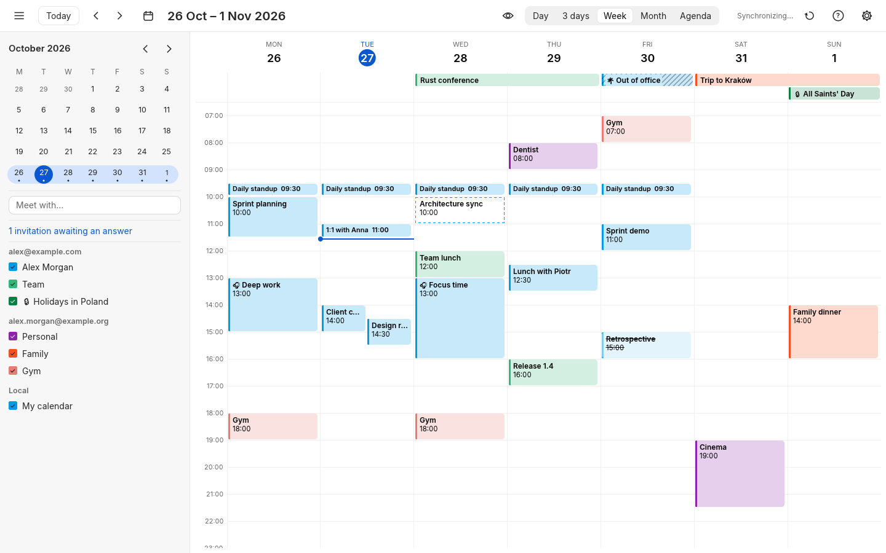
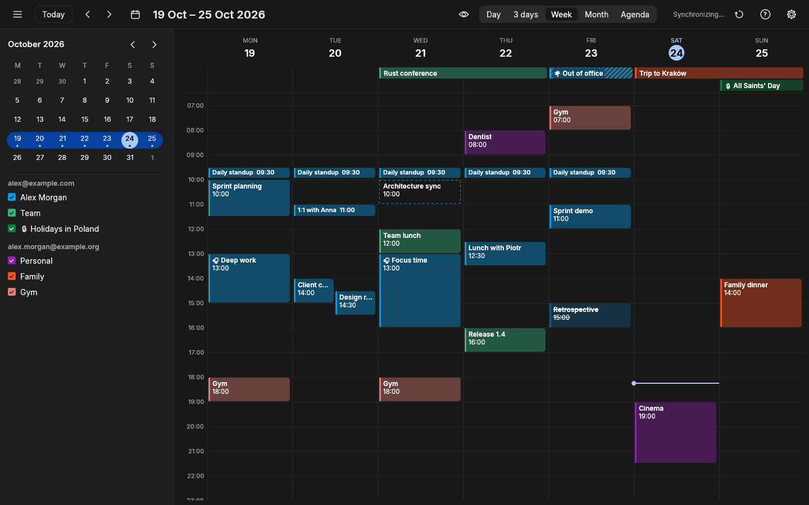
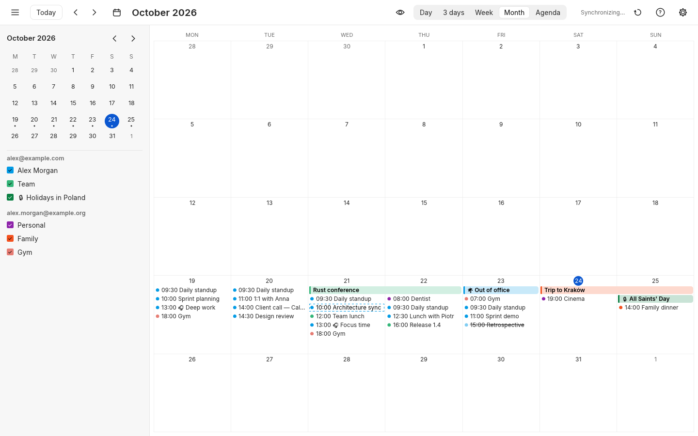
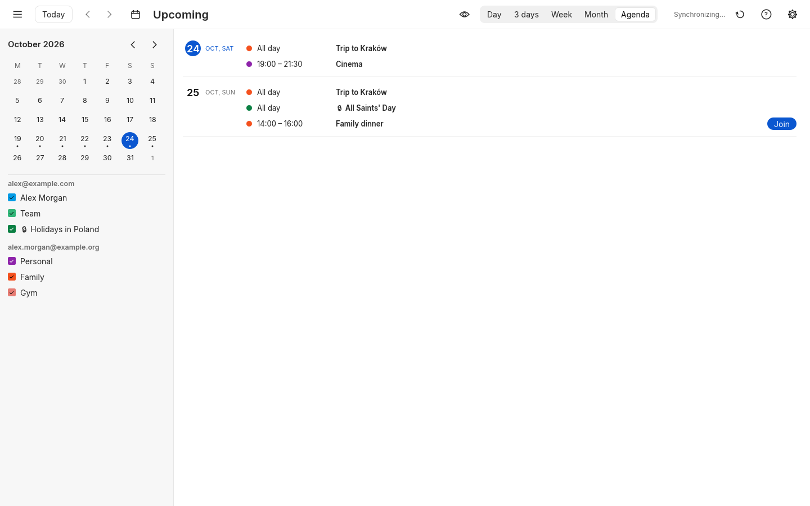
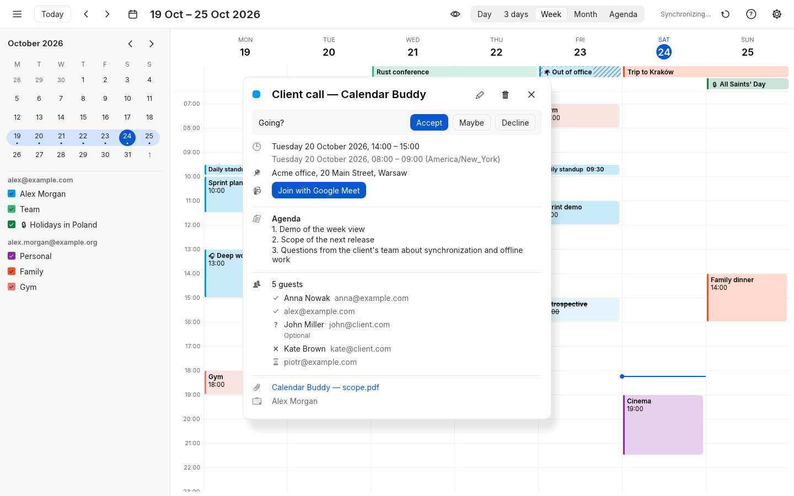
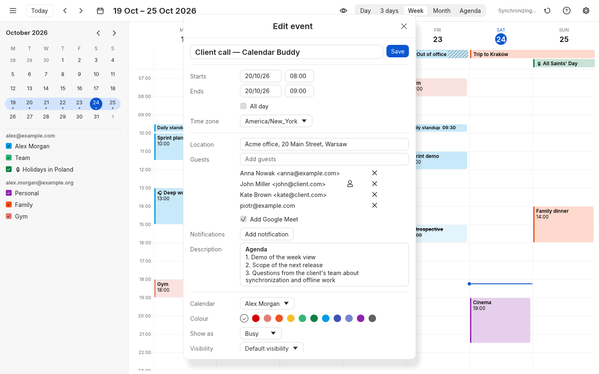
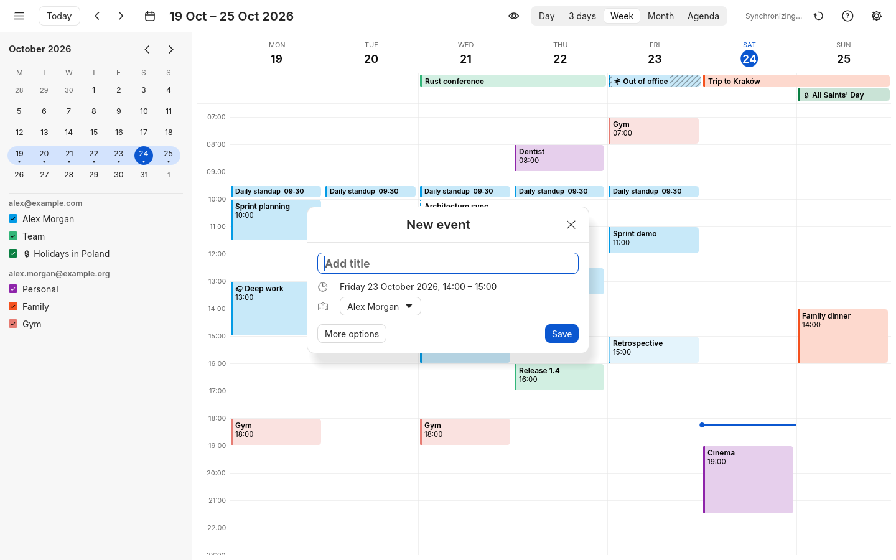
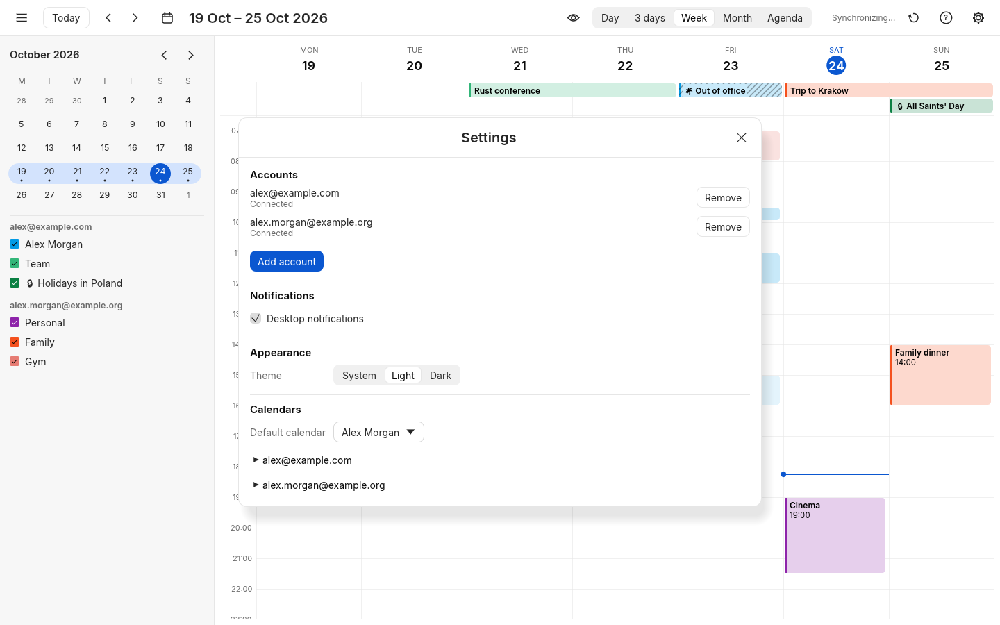

# Calendar Buddy

A lightweight, fast desktop calendar for Linux, connected straight to Google Calendar. It replaces
opening Google Calendar in the browser for everyday work: checking what is next, answering
invitations and setting up meetings with Google Meet. There is no server of its own; the data
stays in Google and in a local cache.


*The pictures show made-up data. They are drawn by the app itself, off screen.*

## What it does

- **Several Google accounts side by side.** Personal and Workspace accounts, their calendars under
  each in the side panel, each with a quick toggle and a colour of your own.
- **Day, 3 days, week, month and agenda.** Overlapping events side by side, multi-day events as
  one bar, a mini calendar with the days that have events, the current time as a line.
- **Events as in Google Calendar.** Create one by clicking or selecting a time; drag it to move it
  or stretch it; edit everything Google has: time zones, repeating events, guests, Google Meet,
  reminders, colour, visibility. Descriptions formatted in Google stay formatted.
- **Invitations.** Answer them from the event, see who comes and who does not, check the guests'
  availability when picking a time, join the call with one click.
- **Works offline.** Everything synchronized can be browsed without a network; changes wait for it.
- **Reminders on the desktop.** Notifications from Google's reminders, with snooze and join, a
  tray icon and starting at login.
- **Keyboard first.** Google Calendar's own shortcuts (`d` `x` `w` `m` `a`, `j` `k`, `t`, `g`, `c`,
  `?`), and the whole app is reachable without a mouse.
- **Light and dark.** Following the system, or chosen in the settings.

## Screenshots

| Week | Week, dark |
| --- | --- |
|  |  |
| **Month** | **Agenda** |
|  |  |
| **An event's details** | **The editor** |
|  |  |
| **A new event** | **Settings** |
|  |  |

## Getting started

Calendar Buddy is built for Ubuntu with KDE Plasma, on Wayland and on X11. It keeps your sign-in
in the system's secret store (KWallet, GNOME Keyring or KeePassXC, through the Secret Service API).

1. Install a recent stable [Rust](https://rustup.rs) toolchain.
2. Set up your own Google OAuth client and save its file to
   `~/.config/calendar-buddy/google-oauth-client.json`, as described in
   [Setting up the Google OAuth client](#setting-up-the-google-oauth-client) below.
3. Run the app:

   ```sh
   cargo run -p calendar-buddy --release
   ```

4. Click **Connect Google account**. Sign-in happens in your browser; the app never sees your
   password. Google warns that the app is not verified: choose **Advanced**, then
   **Go to … (unsafe)**. The app asks to manage your calendars and to read your contacts, to
   suggest guests; on a Workspace account it may also ask to read your organization's directory.

Your calendars are cached in `~/.cache/calendar-buddy/`, your settings in
`~/.config/calendar-buddy/`.

### Setting up the Google OAuth client

Calendar Buddy has no Google client built in: each install talks to Google through an OAuth
client from your own Google Cloud project. You set it up once, in the
[Google Cloud Console](https://console.cloud.google.com/):

1. **Create a project** (or pick one you have) in the project picker at the top.
2. **Enable the APIs.** In *APIs & Services → Library*, enable the **Google Calendar API** and the
   **People API** (the People API suggests guests from your contacts and directory).
3. **Configure the consent screen.** In *Google Auth Platform* (*APIs & Services → OAuth consent
   screen*):
   - *Branding*: an app name (e.g. Calendar Buddy) and your e-mail as the support and developer
     contact.
   - *Audience*: **External**, so any Google account can connect (or **Internal** if you only use
     accounts of one Workspace organization). While the app is in **Testing**, add every account
     you will connect under *Test users*. Google ends a Testing app's sign-ins after 7 days; to
     stay signed in, choose **Publish app** — no verification is needed for your own use, Google
     only shows the unverified-app warning when you connect.
   - *Data access* (optional): add the scopes the app asks for — `…/auth/calendar`,
     `…/auth/contacts.readonly`, `…/auth/contacts.other.readonly` and
     `…/auth/directory.readonly`.
4. **Create the client.** In *Clients* (*APIs & Services → Credentials → Create credentials →
   OAuth client ID*), choose the application type **Desktop app**, give it a name and create it.
   No redirect URI is needed: the app signs in through a loopback address on your machine.
5. **Download the JSON** (*Download JSON* in the dialog, or the download icon next to the client)
   and put it, unchanged, where the app looks for it:

   ```sh
   mkdir -p ~/.config/calendar-buddy
   mv ~/Downloads/client_secret_*.json ~/.config/calendar-buddy/google-oauth-client.json
   ```

   The file starts with `{"installed": {"client_id": …`. If `XDG_CONFIG_HOME` is set, the app
   reads `$XDG_CONFIG_HOME/calendar-buddy/google-oauth-client.json` instead. The file holds your
   client's secret: keep it out of the repository. Without it, **Connect Google account** tells
   you which file to put where.

## Development

The workspace has three crates:

| Crate | What it holds |
| --- | --- |
| `crates/core` (`calendar-core`) | The domain: events, recurrence, synchronization, the SQLite cache and every view's model. No UI toolkit, no Google. |
| `crates/google` (`calendar-google`) | The Google adapter: sign-in (OAuth with PKCE), calendars, events, people. Its tests run against a fake Google. |
| `crates/app` (`calendar-buddy`) | The desktop app, in [egui](https://github.com/emilk/egui): it draws the view models and handles input. |

```sh
cargo test --workspace                                   # all tests
cargo fmt --all --check                                  # the gates run before every commit
cargo clippy --workspace --all-targets -- -D warnings
cargo test -p calendar-buddy preview -- --ignored        # pictures of every screen, in target/preview/
python3 scripts/readme_media.py                          # this README's pictures, from those
```

The pictures come from the app running on made-up data, with no real account, network or
desktop, so they can be drawn anywhere, also to check a change to the look.

The specification lives in [`docs/specs/`](docs/specs/README.md): the requirements by module, the
user stories, the test cases and every decision taken along the way.
